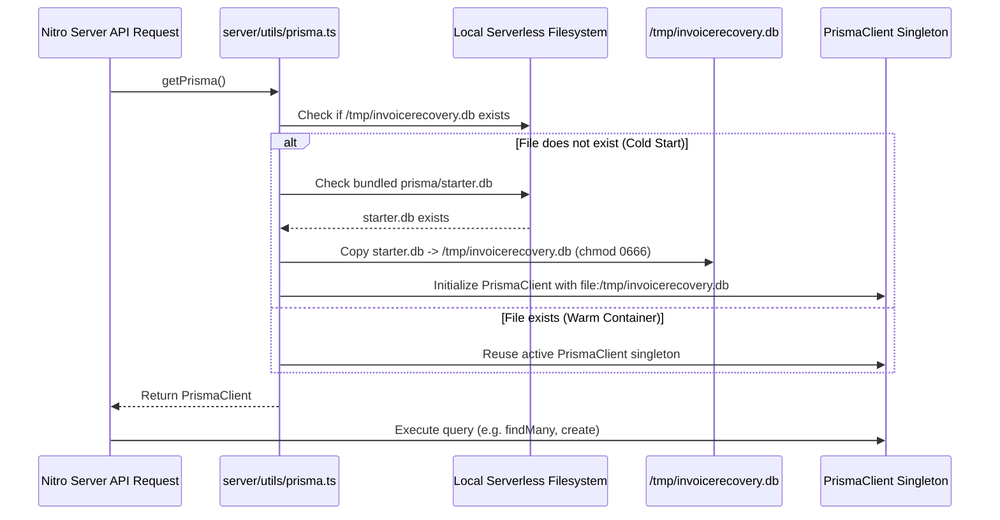
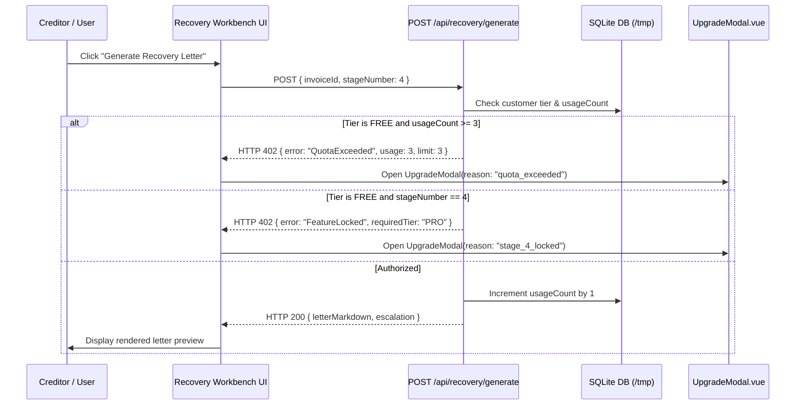

# Technical Architecture Document (ARCHITECTURE.md)
## InvoiceRecovery Studio: Automated Overdue Receivables Recovery & Statutory Debt Legal Engine

- **Product Name**: InvoiceRecovery Studio (`invoice-recovery-studio`)
- **Document Version**: 1.0.0
- **Architect**: Principal System Architect, Autonomous Software Studio (Standards 4.0)
- **Target Release**: Production MVP
- **Framework & Core**: Nuxt 3 (v3.14+), Vue 3 Composition API (`<script setup lang="ts">`), Nitro Engine, TypeScript (Strict).
- **UI & Art Direction**: Radix Vue (`radix-vue`) accessible primitives, Tailwind CSS (`@nuxtjs/tailwindcss`), Lucide Icons (`lucide-vue-next`).
- **Persistence**: Prisma ORM with SQLite Serverless Cold-Start Adapter (`/tmp/invoicerecovery.db`) and bundled `prisma/starter.db`.
- **Monetization**: Native Stripe Checkout SDK, Webhooks, Customer Portal, and Interactive Zero-Friction Sandbox Fallback Simulator.
- **Strict Quality Rule**: **ZERO EMOJIS** across all UI surfaces, buttons, toasts, and badges. 100% semantic Lucide SVG stroke icons. Monospace tabular numbers for financial figures.

---

## 1. System Component Diagram & Folder Tree Layout

### 1.1 High-Level Component Architecture Diagram

```mermaid
flowchart TD
    subgraph Client ["Client Layer (Nuxt 3 / Vue 3 Composition API)"]
        UI["Authoritative Financial UI<br/>(Tailwind CSS + Radix Vue Primitives)"]
        Icons["100% Lucide SVG Icons<br/>(Strictly Zero Emojis)"]
        Motion["@vueuse/motion & CSS<br/>(prefers-reduced-motion Safeguard)"]
        
        subgraph Composables ["Reactive State Composables"]
            UIRecovery["useInvoiceRecovery()<br/>Ledger, Calculations, Escalations, Templates"]
            UIBilling["useBilling()<br/>Tier, Quotas, Stripe Checkout, Sandbox Sim"]
        end

        subgraph Views ["Core Modules & Views"]
            Matrix["Delinquency Aging Matrix<br/>(1-14d, 15-30d, 31-60d, 60+d)"]
            Ledger["Invoice Ledger & Sample Loader"]
            Workbench["Recovery Escalation Studio<br/>(4-Stage Progressive Generator)"]
            Settlement["48h Fast-Settlement Formulator"]
            Export["Dual Export: Letterhead PDF & Clipboard Email"]
            Paywall["UpgradeModal & HTTP 402 Interceptor"]
        end

        UI --> Matrix
        UI --> Ledger
        UI --> Workbench
        UI --> Settlement
        UI --> Export
        UI --> Paywall
        
        Matrix --> UIRecovery
        Ledger --> UIRecovery
        Workbench --> UIRecovery
        Settlement --> UIRecovery
        Paywall --> UIBilling
    end

    subgraph Server ["Nitro Server Engine (Serverless API)"]
        TenantMiddleware["Tenant Resolver Middleware<br/>(Auto-provisions Customer Context)"]
        
        subgraph Endpoints ["API Routes (/api/*)"]
            CalcAPI["/api/recovery/calculate<br/>Statutory Interest & Fixed Fees"]
            GenAPI["/api/recovery/generate<br/>Escalation Letters & Quota Check"]
            SettleAPI["/api/recovery/settlement<br/>48h Discount Waiver Clause"]
            SamplesAPI["/api/invoices/samples<br/>Pre-seeded Realistic Scenarios"]
            InvoiceCRUD["/api/invoices/*<br/>Ledger Operations"]
            TierAPI["/api/me/tier<br/>Quota & Entitlement Status"]
            CheckoutAPI["/api/checkout<br/>Stripe Checkout Session"]
            WebhookAPI["/api/webhooks/stripe<br/>Stripe Lifecycle Listener"]
            PortalAPI["/api/portal<br/>Stripe Customer Portal"]
            SandboxAPI["/api/sandbox/toggle-pro<br/>Zero-Friction Dev/Demo Toggle"]
        end

        subgraph CoreEngines ["Domain Engines (server/utils/*)"]
            StatEngine["Statutory Engine<br/>UK 1998 Act, EU 2011/7, US PPA"]
            TemplateEngine["Escalation Template Engine<br/>4 Stages + Markdown Formatter"]
            StripeEngine["Stripe Client & Webhook Verifier"]
            ColdStartAdapter["Serverless Cold-Start SQLite Adapter<br/>Copies starter.db to /tmp on Init"]
        end

        TenantMiddleware --> Endpoints
        CalcAPI --> StatEngine
        GenAPI --> TemplateEngine
        GenAPI --> StatEngine
        SettleAPI --> StatEngine
        CheckoutAPI --> StripeEngine
        WebhookAPI --> StripeEngine
        Endpoints --> ColdStartAdapter
    end

    subgraph Persistence ["Persistence Layer (Serverless /tmp SQLite)"]
        PrismaClient["Prisma ORM Client"]
        TmpDB["/tmp/invoicerecovery.db<br/>(Writable Ephemeral SQLite)"]
        StarterDB["prisma/starter.db<br/>(Bundled Read-Only Template)"]
        
        ColdStartAdapter -->|Sync if Missing| TmpDB
        StarterDB -.->|Initial Copy| ColdStartAdapter
        PrismaClient --> TmpDB
    end

    subgraph External ["External Services"]
        StripeHosted["Stripe Checkout & Billing Portal"]
    end

    Composables -->|Fetch / REST| Endpoints
    CheckoutAPI -->|Create Session| StripeHosted
    WebhookAPI <---|Webhook Events| StripeHosted
    ColdStartAdapter --> PrismaClient
```



---

### 1.2 Exact Directory and File Tree Layout

```
invoice-recovery-studio/
├── .env.example
├── .gitignore
├── CONCEPT.md
├── PRD.md
├── ARCHITECTURE.md
├── README.md
├── nuxt.config.ts
├── package.json
├── pnpm-lock.yaml
├── tailwind.config.ts
├── tsconfig.json
├── prisma/
│   ├── schema.prisma                  # Customer, Invoice, RecoveryEscalation models
│   ├── starter.db                     # Bundled pre-migrated starter database
│   └── seed.ts                        # Seed script with realistic commercial invoices
├── server/
│   ├── api/
│   │   ├── checkout.post.ts           # Stripe Checkout session creator (with sandbox fallback)
│   │   ├── portal.post.ts             # Stripe Customer Portal session generator
│   │   ├── me/
│   │   │   └── tier.get.ts            # Current customer entitlement and quota tracking
│   │   ├── sandbox/
│   │   │   └── toggle-pro.post.ts     # Instant sandbox Pro/Free entitlement toggle
│   │   ├── webhooks/
│   │   │   └── stripe.post.ts         # Stripe event listener (checkout, subscription updates)
│   │   ├── invoices/
│   │   │   ├── index.get.ts           # Fetch customer invoices with aging calculations
│   │   │   ├── index.post.ts          # Create new invoice
│   │   │   ├── [id].put.ts            # Update invoice or mark as RESOLVED
│   │   │   ├── [id].delete.ts         # Delete invoice record
│   │   │   └── samples.get.ts         # Return/seed pre-configured realistic agency scenarios
│   │   └── recovery/
│   │       ├── calculate.post.ts      # Multi-jurisdiction statutory interest & fee calculator
│   │       ├── generate.post.ts       # 4-stage escalation letter generator (with quota gate)
│   │       └── settlement.post.ts     # 48-hour conditional fast-settlement discount builder
│   ├── middleware/
│   │   └── customer.ts                # Tenant resolution middleware (ensures customer context)
│   └── utils/
│       ├── prisma.ts                  # Serverless /tmp cold-start SQLite adapter singleton
│       ├── statutoryRates.ts          # Pure TS UK, EU, US interest & compensation fee rules
│       ├── letterTemplates.ts         # Pure TS 4-stage escalation notice markdown templates
│       └── stripe.ts                  # Stripe SDK client & webhook signature verification
├── composables/
│   ├── useInvoiceRecovery.ts          # Ledger state, statutory calculations, letters, samples
│   └── useBilling.ts                  # Customer tier, 3-letter quota tracking, paywalls, sandbox
├── types/
│   ├── recovery.ts                    # Statutory calculation, escalation stage, and letter types
│   ├── billing.ts                     # Tier enums, quota states, Stripe checkout payloads
│   └── database.ts                    # Prisma model type mappings and view-model interfaces
├── components/
│   ├── layout/
│   │   ├── AppHeader.vue              # Top navigation, brand badge, tier status, sandbox button
│   │   ├── AppFooter.vue              # Standards 4.0 disclaimer, statutory legal notices
│   │   └── SandboxStatusBar.vue       # Persistent subtle banner when running in Sandbox Pro mode
│   ├── ui/                            # Radix Vue accessible headless primitives + Tailwind
│   │   ├── RadixDialog.vue            # Accessible modal dialog wrapper
│   │   ├── RadixDropdown.vue          # Accessible dropdown action menu
│   │   ├── RadixTabs.vue              # Accessible escalation & filter tabs
│   │   ├── RadixTooltip.vue           # Accessible tooltip helper for legal terms
│   │   ├── RadixSwitch.vue            # Headless toggle switch for fast-settlement
│   │   ├── RadixSlider.vue            # Accessible slider for settlement discount percentage
│   │   ├── BaseButton.vue             # Institutional executive button (Primary, Secondary, Ghost)
│   │   ├── StatusBadge.vue            # Delinquency & recovery status badge with semantic color
│   │   └── ToastContainer.vue         # Epistemic clipboard and recovery feedback toasts
│   ├── matrix/
│   │   ├── DelinquencyMatrix.vue      # 4-bucket visual aging container (1-14d, 15-30d, 31-60d, 60+d)
│   │   ├── AgingBucketCard.vue        # Individual delinquency bucket metric card
│   │   └── LedgerSummaryCards.vue     # Total Principal, Accrued Interest, Fixed Fees, Total Claim
│   ├── ledger/
│   │   ├── InvoiceLedgerTable.vue     # High-density data table with sorting and bucket filtering
│   │   ├── AddInvoiceModal.vue        # Form dialog for adding custom invoices
│   │   └── SampleLoaderBar.vue        # 1-Click preset scenario loader (Apex, OmniCloud, Vanguard)
│   ├── studio/
│   │   ├── RecoveryWorkbench.vue      # Main recovery workspace combining stages & live preview
│   │   ├── EscalationStageTabs.vue    # Stage 1 to 4 selector with lock badges for Free tier
│   │   ├── LetterPreviewPane.vue      # Live markdown/formatted notice preview
│   │   ├── SettlementDiscountControl.vue # 48h discount toggle, percentage slider, and waiver preview
│   │   └── DualExportToolbar.vue      # 1-Click Clipboard Email copy and PDF Letterhead trigger
│   ├── export/
│   │   └── PrintableLetterhead.vue    # Formal legal letterhead view optimized for print / PDF save
│   └── billing/
│       ├── UpgradeModal.vue           # High-converting paywall dialog triggered by HTTP 402 or locks
│       ├── PlanComparisonCard.vue     # Pro Monthly ($29) vs Founder Lifetime ($79) comparison
│       └── QuotaExceededBanner.vue    # Inline notice when Free tier reaches 3/3 letter quota
├── assets/
│   └── css/
│       └── tailwind.css               # Standards 4.0 design tokens, print CSS, typography rules
├── app.vue                            # Root app shell, font declarations, toast host
└── pages/
    └── index.vue                      # Executive single-page command dashboard
```

---

## 2. Complete `schema.prisma` Model Definitions

The data model uses SQLite for frictionless zero-configuration execution. It strictly implements the requested `Customer`, `Invoice`, and `RecoveryEscalation` specifications, maintaining full relational integrity.

```prisma
datasource db {
  provider = "sqlite"
  url      = env("DATABASE_URL")
}

generator client {
  provider = "prisma-client-js"
}

// Customer model: Handles tenancy, tier entitlement (FREE, PRO, LIFETIME), and usage quota tracking
model Customer {
  id               String               @id @default(uuid())
  email            String               @unique
  organizationName String               @default("Independent Studio")
  stripeCustomerId String?              @unique
  subscriptionId   String?
  tier             String               @default("FREE") // "FREE", "PRO", "LIFETIME"
  usageCount       Int                  @default(0)       // Incremented on letter generation
  quotaLimit       Int                  @default(3)       // Free tier default: 3 letters / month
  quotaResetDate   DateTime             @default(now())
  createdAt        DateTime             @default(now())
  updatedAt        DateTime             @updatedAt
  
  // Relations
  invoices         Invoice[]

  @@index([email])
  @@index([stripeCustomerId])
}

// Invoice model: Stores client debt records, jurisdictions, and aging delinquency parameters
model Invoice {
  id                   String               @id @default(uuid())
  customerId           String
  invoiceNumber        String               // e.g. "INV-2026-089"
  clientName           String               // Debtor company or principal name
  clientEmail          String?
  clientAddress        String?              // Required for formal PDF letterhead
  clientCompanyNumber  String?              // e.g. UK Companies House # or US EIN
  issueDate            DateTime
  dueDate              DateTime
  principalAmount      Float                // Outstanding face value
  currency             String               @default("USD") // "USD", "GBP", "EUR"
  jurisdiction         String               @default("US")  // "US", "UK", "EU"
  status               String               @default("OVERDUE") // "PENDING", "OVERDUE", "RESOLVED"
  notes                String?
  createdAt            DateTime             @default(now())
  updatedAt            DateTime             @updatedAt

  // Relations
  customer             Customer             @relation(fields: [customerId], references: [id], onDelete: Cascade)
  escalations          RecoveryEscalation[]

  @@index([customerId])
  @@index([status])
  @@index([dueDate])
}

// RecoveryEscalation model: Snapshot of a generated recovery escalation notice and calculated claims
model RecoveryEscalation {
  id                       String    @id @default(uuid())
  invoiceId                String
  stageNumber              Int       // 1: Courtesy, 2: Administrative, 3: Statutory, 4: Legal LBA
  stageName                String    // Descriptive stage name
  daysOverdue              Int       // Snapshot of days past due at generation
  interestAccrued          Float     // Calculated statutory interest
  statutoryFee             Float     // Fixed statutory compensation fee (£40-£100, €40, $0)
  totalClaimAmount         Float     // principalAmount + interestAccrued + statutoryFee
  letterMarkdown           String    // Complete interpolated letter content
  settlementDiscountAmount Float?    // Discount value if 48h settlement active
  settlementDeadline       DateTime? // Expiration timestamp for fast settlement (now + 48h)
  generatedAt              DateTime  @default(now())

  // Relations
  invoice                  Invoice   @relation(fields: [invoiceId], references: [id], onDelete: Cascade)

  @@index([invoiceId])
  @@index([stageNumber])
}
```

---

## 3. Serverless Cold-Start Deployment Strategy

### 3.1 The Ephemeral Serverless Problem & Solution
On platforms like Vercel, AWS Lambda, or Netlify Functions, the file system is strictly **read-only** except for `/tmp`. Standard SQLite files in project roots cannot be written to or updated, causing runtime crashes when creating invoices or tracking letter generation quotas.

**InvoiceRecovery Studio solves this via the Serverless Cold-Start SQLite Adapter Pattern (`server/utils/prisma.ts`)**:



### 3.2 Implementation Specification (`server/utils/prisma.ts`)

```typescript
import { PrismaClient } from '@prisma/client'
import fs from 'node:fs'
import path from 'node:path'

let prismaInstance: PrismaClient | null = null

export function getPrisma(): PrismaClient {
  if (prismaInstance) {
    return prismaInstance
  }

  const isServerless = process.env.VERCEL || process.env.NETLIFY || process.env.AWS_LAMBDA_FUNCTION_NAME
  const dbPath = isServerless ? '/tmp/invoicerecovery.db' : path.resolve(process.cwd(), 'prisma/dev.db')
  const dbUrl = `file:${dbPath}`

  // Ensure /tmp database exists on cold start by copying bundled starter.db
  if (isServerless && !fs.existsSync(dbPath)) {
    const starterPath = path.resolve(process.cwd(), 'prisma/starter.db')
    if (fs.existsSync(starterPath)) {
      try {
        fs.copyFileSync(starterPath, dbPath)
        fs.chmodSync(dbPath, 0o666)
      } catch (err) {
        console.error('Failed to copy starter.db to /tmp:', err)
      }
    }
  }

  prismaInstance = new PrismaClient({
    datasources: {
      db: {
        url: dbUrl
      }
    },
    log: process.env.NODE_ENV === 'development' ? ['warn', 'error'] : ['error']
  })

  return prismaInstance
}
```

---

## 4. Nitro Server API Route Specifications

All API endpoints reside under `server/api/` and leverage Nitro's lightweight file-based routing.

### 4.1 Route Matrix Summary

| Route | Method | Access | Description |
| :--- | :--- | :--- | :--- |
| `POST /api/recovery/calculate` | `POST` | Public / Free | Pure statutory calculation for US, UK, EU debt claims |
| `POST /api/recovery/generate` | `POST` | Gated (3/mo Free) | 4-stage escalation letter generator; returns HTTP 402 on quota breach |
| `POST /api/recovery/settlement` | `POST` | Pro / Gated | Generates 48-hour conditional settlement waiver text & figures |
| `GET /api/invoices/samples` | `GET` | Public / Free | Returns realistic pre-configured agency scenarios |
| `GET /api/invoices` | `GET` | Authenticated | Retrieves current ledger invoices with aging metadata |
| `POST /api/invoices` | `POST` | Authenticated | Creates a new invoice in the ledger |
| `PUT /api/invoices/:id` | `PUT` | Authenticated | Updates invoice details or marks status as `RESOLVED` |
| `DELETE /api/invoices/:id` | `DELETE` | Authenticated | Removes invoice from ledger |
| `GET /api/me/tier` | `GET` | Authenticated | Retrieves customer entitlement, usageCount, and quotaLimit |
| `POST /api/checkout` | `POST` | Public | Initiates Stripe Checkout session (or returns sandbox simulation URL) |
| `POST /api/webhooks/stripe` | `POST` | Public (Stripe) | Idempotent webhook listener for subscription lifecycle events |
| `POST /api/portal` | `POST` | Subscribed | Generates Stripe Customer Billing Portal session URL |
| `POST /api/sandbox/toggle-pro` | `POST` | Demo / Test | Toggles active customer between `FREE` and `PRO` instantly |

---

### 4.2 Endpoint Contracts

#### 1. `POST /api/recovery/calculate`
Calculates statutory interest and statutory debt compensation fees strictly according to territorial statutes.

- **Request Body**:
  ```json
  {
    "principalAmount": 8500.00,
    "currency": "USD",
    "jurisdiction": "US",
    "dueDate": "2026-08-15T00:00:00.000Z",
    "targetDate": "2026-10-17T00:00:00.000Z"
  }
  ```
- **Response Body (`200 OK`)**:
  ```json
  {
    "principalAmount": 8500.00,
    "currency": "USD",
    "jurisdiction": "US",
    "daysOverdue": 63,
    "statuteName": "US Commercial Prompt Payment Standard (12.0% p.a.)",
    "annualRatePercent": 12.00,
    "dailyInterestRate": 0.000328767,
    "dailyAccrualAmount": 2.79,
    "accruedInterest": 176.05,
    "statutoryCompensationFee": 0.00,
    "totalClaimAmount": 8676.05,
    "statutoryCitation": "Calculated pursuant to standard commercial late payment rates (1.0% per month) under US commercial terms."
  }
  ```

#### 2. `POST /api/recovery/generate`
Generates a progressive escalation notice. Evaluates tier access and enforces the 3-letter Free monthly quota.

- **Request Body**:
  ```json
  {
    "invoiceId": "c8b9d4e2-...",
    "stageNumber": 4,
    "includeSettlement": true,
    "settlementDiscountPct": 8.0,
    "creditorInfo": {
      "companyName": "Apex Studio LLC",
      "signatory": "Marcus Vance, Managing Principal",
      "remittanceDetails": "Wire: ABA 021000021 / Acc: 9876543210"
    }
  }
  ```
- **Quota Enforced Response (`402 Payment Required`)**:
  ```json
  {
    "statusCode": 402,
    "error": "QuotaExceeded",
    "message": "You have utilized your 3 free recovery letters for this month. Upgrade to Pro for unlimited generation.",
    "currentUsage": 3,
    "quotaLimit": 3,
    "upgradeUrl": "/api/checkout?plan=pro_monthly"
  }
  ```
- **Feature Gated Response (`402 Payment Required`)**:
  ```json
  {
    "statusCode": 402,
    "error": "FeatureLocked",
    "message": "Stage 4: Formal Legal Demand (Letter Before Action) is restricted to Pro and Lifetime tiers.",
    "requiredTier": "PRO"
  }
  ```
- **Success Response (`200 OK`)**:
  ```json
  {
    "escalation": {
      "id": "e9a1b2c3-...",
      "invoiceId": "c8b9d4e2-...",
      "stageNumber": 4,
      "stageName": "Formal Legal Demand (Letter Before Action)",
      "daysOverdue": 63,
      "interestAccrued": 176.05,
      "statutoryFee": 0.00,
      "totalClaimAmount": 8676.05,
      "settlementDiscountAmount": 680.00,
      "settlementDeadline": "2026-10-19T21:00:00.000Z",
      "generatedAt": "2026-10-17T21:00:00.000Z"
    },
    "subjectLine": "FORMAL DEMAND FOR PAYMENT: Invoice INV-2026-089 (Pre-Action Legal Notice)",
    "letterMarkdown": "# FORMAL DEMAND FOR IMMEDIATE SETTLEMENT...",
    "quotaRemaining": 0
  }
  ```

#### 3. `POST /api/recovery/settlement`
Formulates a 48-hour conditional prompt payment settlement offer with strict waiver language.

- **Request Body**:
  ```json
  {
    "principalAmount": 10000.00,
    "currency": "USD",
    "discountPct": 8.0,
    "windowHours": 48
  }
  ```
- **Response Body (`200 OK`)**:
  ```json
  {
    "originalPrincipal": 10000.00,
    "discountPct": 8.0,
    "discountAmount": 800.00,
    "settlementAmount": 9200.00,
    "windowHours": 48,
    "deadlineIso": "2026-10-19T21:15:00.000Z",
    "clauseMarkdown": "CONDITIONAL PROMPT SETTLEMENT OFFER:\nAs a commercial courtesy to facilitate immediate accounts closure, Creditor offers a conditional concession of 8.0% ($800.00). Remittance of exactly $9,200.00 received in cleared funds prior to October 19, 2026 21:15 UTC shall constitute full and final satisfaction of this invoice.\n\nSTRICT CONDITIONAL WAIVER NOTICE:\nFailure to remit the discounted amount in cleared funds prior to the stated deadline shall immediately render this offer null and void. The full principal balance of $10,000.00 plus accrued statutory interest and recovery fees shall remain due and payable in full without further notice."
  }
  ```

#### 4. `GET /api/invoices/samples`
Returns realistic, pre-configured agency scenarios for instant 1-click loading.

- **Response Body (`200 OK`)**:
  ```json
  [
    {
      "invoiceNumber": "INV-2026-045",
      "clientName": "Apex Digital Branding",
      "clientEmail": "ap@apexdigital.example.com",
      "clientAddress": "100 Broadway, Ste 400, New York, NY 10005",
      "principalAmount": 8500.00,
      "currency": "USD",
      "jurisdiction": "US",
      "daysOverdue": 45,
      "status": "OVERDUE",
      "notes": "Q2 Brand design & design system sprint milestone."
    },
    {
      "invoiceNumber": "INV-UK-882",
      "clientName": "OmniCloud Solutions Ltd",
      "clientEmail": "finance@omnicloud.example.co.uk",
      "clientAddress": "12 Chiswell Street, London EC1Y 4UP",
      "principalAmount": 14200.00,
      "currency": "GBP",
      "jurisdiction": "UK",
      "daysOverdue": 18,
      "status": "OVERDUE",
      "notes": "Kubernetes migration & multi-region deployment contract."
    },
    {
      "invoiceNumber": "INV-EU-109",
      "clientName": "Vanguard Consulting GmbH",
      "clientEmail": "rechnung@vanguard.example.de",
      "clientAddress": "Taunusanlage 8, 60329 Frankfurt am Main",
      "principalAmount": 4800.00,
      "currency": "EUR",
      "jurisdiction": "EU",
      "daysOverdue": 72,
      "status": "OVERDUE",
      "notes": "Strategic digital transformation retainer - Net 30."
    }
  ]
  ```

#### 5. `GET /api/me/tier`
Returns active customer entitlement, usage counters, and remaining quota.

- **Response Body (`200 OK`)**:
  ```json
  {
    "id": "c1a2b3d4-...",
    "email": "principal@studio.example.com",
    "tier": "FREE",
    "usageCount": 1,
    "quotaLimit": 3,
    "quotaRemaining": 2,
    "isPro": false,
    "isLifetime": false,
    "hasReachedQuota": false,
    "quotaResetDate": "2026-11-01T00:00:00.000Z"
  }
  ```

#### 6. `POST /api/checkout`
Creates a Stripe Checkout Session or returns the sandbox simulation fallback.

- **Request Body**:
  ```json
  {
    "plan": "pro_monthly" // "pro_monthly" ($29) or "lifetime" ($79)
  }
  ```
- **Response Body (Live Stripe `200 OK`)**:
  ```json
  {
    "checkoutUrl": "https://checkout.stripe.com/c/pay/cs_test_a1b2c3d4..."
  }
  ```
- **Response Body (Sandbox Fallback `200 OK`)**:
  ```json
  {
    "isSandbox": true,
    "message": "Stripe API keys not configured. Simulating upgrade directly.",
    "simulatedTier": "PRO"
  }
  ```

#### 7. `POST /api/sandbox/toggle-pro`
Instantaneously flips entitlement between `FREE` and `PRO` for offline testing and evaluator demonstrations.

- **Response Body (`200 OK`)**:
  ```json
  {
    "success": true,
    "newTier": "PRO",
    "message": "Sandbox Mode: Pro entitlements activated successfully."
  }
  ```

---

## 5. Frontend Component Hierarchy and State Flow

### 5.1 Component Hierarchy Tree

```
pages/index.vue (Executive Command Dashboard)
├── AppHeader
│   ├── BrandIdentity ("InvoiceRecovery Studio" + Scale Lucide Icon)
│   ├── QuotaPill (Displays Free 1/3 or Pro Active Badge)
│   ├── SandboxSimButton (Instant Free <-> Pro Toggle)
│   └── BaseButton ("Upgrade to Pro") -> opens UpgradeModal
│
├── SandboxStatusBar (Visible only when in Sandbox PRO mode)
│
├── main.container
│   ├── Section 1: Financial Delinquency Aging Matrix
│   │   ├── LedgerSummaryCards (4 Top Metrics: Outstanding Principal, Interest, Fees, Total Claim)
│   │   └── DelinquencyMatrix (4 Aging Buckets with active selection & counts)
│   │       ├── AgingBucketCard ("1–14 Days: Grace & Courtesy")
│   │       ├── AgingBucketCard ("15–30 Days: Administrative Delay")
│   │       ├── AgingBucketCard ("31–60 Days: Critical Delinquency")
│   │       └── AgingBucketCard ("60+ Days: Default & Pre-Action")
│   │
│   ├── Section 2: Invoice Ledger Management
│   │   ├── SampleLoaderBar (1-Click Presets: Apex $8.5k, OmniCloud £14.2k, Vanguard €4.8k)
│   │   ├── InvoiceLedgerTable
│   │   │   ├── TableHeaders (Invoice #, Debtor, Principal, Overdue, Accrued, Total, Actions)
│   │   │   ├── TableRows (Interactive row selection, Mark Resolved, Delete)
│   │   │   └── EmptyState (Zero-emoji authoritative graphic with "Load Samples" CTA)
│   │   └── AddInvoiceModal (RadixDialog containing invoice input fields)
│   │
│   └── Section 3: Recovery Escalation Studio Workbench
│       ├── InvoiceContextBanner (Selected Invoice #, Debtor, Days Overdue, Total Claim)
│       ├── EscalationStageTabs (RadixTabs for Stages 1, 2, 3, 4 with Pro lock indicators)
│       │   ├── StageTab 1: Courtesy Check-in (1–14d)
│       │   ├── StageTab 2: Firm Administrative Notice (15–30d)
│       │   ├── StageTab 3: Statutory Accrual Warning (31–60d)
│       │   └── StageTab 4: Formal Legal Demand / LBA (60+d) [PRO Locked]
│       │
│       ├── SettlementDiscountControl (RadixVue Switch + Slider)
│       │   ├── RadixSwitch ("Offer 48-Hour Prompt Settlement Discount")
│       │   ├── RadixSlider (5% – 15% discount selector)
│       │   └── ComputedSettlementSummary (Original, Savings, Payable Within 48h)
│       │
│       ├── LetterPreviewPane
│       │   ├── SubjectLineHeader (Editable / Copyable Subject Line)
│       │   └── LetterContentMarkdown (Formatted notice with tabular debt breakdown)
│       │
│       └── DualExportToolbar
│           ├── BaseButton ("Copy Email to Clipboard" + Copy Lucide Icon)
│           ├── BaseButton ("Download Formal PDF Letterhead" + Download Lucide Icon) [PRO]
│           └── QuotaRemainingIndicator (Free 2/3 letters remaining)
│
├── PrintableLetterhead (Hidden on screen, rendered exclusively via @media print)
├── UpgradeModal (RadixDialog presenting $29/mo and $79 LTD plans + Sandbox Sim)
├── ToastContainer (Radix-compatible toast notification queue)
└── AppFooter (Statutory citations: UK 1998 Act, EU 2011/7/EU, US PPA, Zero-emoji badge)
```

---

### 5.2 Reactive State Architecture (`composables/`)

#### Composable 1: `useInvoiceRecovery.ts`
Manages the invoice ledger, delinquency calculation, active selection, escalation generation, and export workflows.

```typescript
// composables/useInvoiceRecovery.ts
import { ref, computed } from 'vue'
import type { Invoice, RecoveryEscalation, StatutoryCalculation } from '~/types/recovery'

export function useInvoiceRecovery() {
  const invoices = ref<Invoice[]>([])
  const selectedInvoiceId = ref<string | null>(null)
  const selectedStage = ref<number>(1)
  const activeBucket = ref<string>('ALL') // 'ALL', '1-14', '15-30', '31-60', '60+'
  
  // Settlement state
  const isSettlementActive = ref<boolean>(false)
  const settlementDiscountPct = ref<number>(8.0)
  
  // Current generated notice state
  const currentEscalation = ref<RecoveryEscalation | null>(null)
  const currentLetterMarkdown = ref<string>('')
  const currentSubjectLine = ref<string>('')
  const isCalculating = ref<boolean>(false)
  const isGenerating = ref<boolean>(false)

  // Computed: Selected invoice
  const selectedInvoice = computed(() => 
    invoices.value.find(inv => inv.id === selectedInvoiceId.value) || null
  )

  // Computed: Ledger Summary Totals
  const ledgerTotals = computed(() => {
    let principal = 0
    let interest = 0
    let fees = 0
    let totalClaim = 0

    for (const inv of invoices.value) {
      if (inv.status !== 'RESOLVED') {
        principal += inv.principalAmount
        interest += inv.accruedInterest || 0
        fees += inv.statutoryFee || 0
        totalClaim += (inv.principalAmount + (inv.accruedInterest || 0) + (inv.statutoryFee || 0))
      }
    }

    return { principal, interest, fees, totalClaim }
  })

  // Core methods:
  // - fetchInvoices(): Loads invoices from /api/invoices
  // - loadSampleInvoices(): Calls /api/invoices/samples and seeds ledger
  // - addInvoice(payload): POST /api/invoices
  // - markAsResolved(id): PUT /api/invoices/:id
  // - deleteInvoice(id): DELETE /api/invoices/:id
  // - calculateStatutoryDebt(invoice): POST /api/recovery/calculate
  // - generateEscalationLetter(stage): POST /api/recovery/generate (handles HTTP 402)
  // - copyEmailToClipboard(): Copies subject line and body to navigator.clipboard
  // - printPdfLetterhead(): Invokes window.print() targeting #printable-letterhead

  return {
    invoices,
    selectedInvoiceId,
    selectedInvoice,
    selectedStage,
    activeBucket,
    isSettlementActive,
    settlementDiscountPct,
    currentEscalation,
    currentLetterMarkdown,
    currentSubjectLine,
    isCalculating,
    isGenerating,
    ledgerTotals
  }
}
```

#### Composable 2: `useBilling.ts`
Manages customer entitlement, quota tracking, paywall modals, Stripe checkout redirects, and sandbox simulations.

```typescript
// composables/useBilling.ts
import { ref, computed } from 'vue'
import type { CustomerTier, CustomerBillingState } from '~/types/billing'

export function useBilling() {
  const billingState = ref<CustomerBillingState>({
    id: '',
    email: '',
    tier: 'FREE',
    usageCount: 0,
    quotaLimit: 3,
    quotaResetDate: new Date().toISOString()
  })
  
  const isUpgradeModalOpen = ref<boolean>(false)
  const upgradeTriggerReason = ref<string>('')
  const isProcessingCheckout = ref<boolean>(false)

  const isPro = computed(() => 
    billingState.value.tier === 'PRO' || billingState.value.tier === 'LIFETIME'
  )
  
  const isLifetime = computed(() => 
    billingState.value.tier === 'LIFETIME'
  )

  const hasReachedQuota = computed(() => 
    !isPro.value && billingState.value.usageCount >= billingState.value.quotaLimit
  )

  const quotaRemaining = computed(() => 
    Math.max(0, billingState.value.quotaLimit - billingState.value.usageCount)
  )

  // Methods:
  // - fetchTier(): GET /api/me/tier
  // - triggerPaywall(reason: string): Opens UpgradeModal with contextual message
  // - initiateCheckout(plan: 'pro_monthly' | 'lifetime'): Calls /api/checkout
  // - openCustomerPortal(): POST /api/portal
  // - toggleSandboxPro(): POST /api/sandbox/toggle-pro (instant reactive toggle)
  // - handleApiError(error: any): Intercepts 402 errors and automatically triggers UpgradeModal

  return {
    billingState,
    isUpgradeModalOpen,
    upgradeTriggerReason,
    isProcessingCheckout,
    isPro,
    isLifetime,
    hasReachedQuota,
    quotaRemaining
  }
}
```

---

## 6. Built-in Monetization & Stripe Sandbox Fallback Architecture

### 6.1 Monetization Matrix & Feature Gates

```
+-------------------------------------------------------------------------------------------------------+
| FEATURE ENTITLEMENT           | FREE STARTER ($0)             | PRO ($29/MO) / LIFETIME ($79 LTD)     |
+-------------------------------------------------------------------------------------------------------+
| Monthly Letter Generations    | 3 letters / month             | UNLIMITED                             |
| Delinquency Aging Matrix      | Up to 3 active invoices       | UNLIMITED active invoices             |
| Statutory Interest Engine     | Basic estimation rate         | Full UK 1998, EU 2011/7, US PPA rules |
| Statutory Fixed Recovery Fees | Hidden / generic              | Itemized £40-£100 or €40 fee breakdown|
| Escalation Sequence Access    | Stage 1 & Stage 2 only        | Full 4 Stages (incl. Legal Demand)    |
| Stage 4 Letter Before Action  | LOCKED (Paywall Modal)        | FULLY UNLOCKED & EDITABLE             |
| 48h Fast Settlement Formulator| LOCKED (Paywall Modal)        | FULLY UNLOCKED with waiver clauses    |
| Formal Letterhead PDF Export  | LOCKED (Paywall Modal)        | FULLY UNLOCKED with clean print CSS   |
| 1-Click Clipboard Email Copy  | Included                      | Included                              |
+-------------------------------------------------------------------------------------------------------+
```

### 6.2 Quota Gating & HTTP 402 Paywall Flow



### 6.3 Zero-Friction Developer Sandbox Fallback
If the application runs without live Stripe API keys (`STRIPE_SECRET_KEY` is not present in `.env`), the platform executes the **Sandbox Fallback Mode**:
1. Clicking **"Upgrade to Pro Monthly"** or **"Get Lifetime Access"** seamlessly falls back to local session simulation.
2. The user can also toggle Pro entitlement at any moment via the **"Simulate Pro Upgrade (Sandbox)"** button in the header and inside `UpgradeModal`.
3. Calling `POST /api/sandbox/toggle-pro` flips `tier: "PRO"` on the active tenant record in `/tmp/invoicerecovery.db`.
4. Reactive composables refresh automatically—instantly unlocking Stage 4 LBA, the 48-hour settlement formulator, unlimited letter generation, and formal PDF letterhead export.

---

## 7. Bespoke Design Tokens, Typography, and Palette (Standards 4.0)

InvoiceRecovery Studio adopts an **authoritative financial light theme** engineered to reflect the institutional gravitas of Bloomberg Law, Stripe Invoicing, and Carta.

### 7.1 Palette Specifications

```css
/* assets/css/tailwind.css - Standards 4.0 Authoritative Financial Theme */
:root {
  /* Canvas & Containers */
  --color-canvas: #f8fafc;        /* Subtle warm slate background (slate-50) */
  --color-surface: #ffffff;       /* Pure clinical white card surface */
  --color-inset: #f1f5f9;         /* Recessed wells, table headers (slate-100) */
  --color-border: #e2e8f0;        /* Crisp hairline separation borders (slate-200) */
  --color-border-subtle: #cbd5e1; /* Subtle input and frame borders (slate-300) */

  /* Typography */
  --color-text-primary: #0f172a;  /* Deep authoritative slate (slate-900) */
  --color-text-secondary: #475569;/* Legible supporting copy (slate-600) */
  --color-text-muted: #64748b;    /* Metadata, captions, placeholders (slate-500) */

  /* Semantic Financial Accents */
  --color-navy-brand: #1e3a8a;    /* Royal Navy primary authority accent (blue-900) */
  --color-emerald-rec: #059669;   /* Recovered / Paid indicator (emerald-600) */
  --color-amber-warn: #d97706;    /* 31-60d Delinquency warning (amber-600) */
  --color-crimson-due: #dc2626;   /* 60+d Critical Overdue / Legal Notice (red-600) */
  --color-blue-admin: #2563eb;    /* 15-30d Administrative marker (blue-600) */
  --color-focus-ring: #2563eb;    /* Keyboard focus ring */
}
```

### 7.2 Typography Tokens & Tabular Alignments

| Role | Font Family | CSS Classes | Usage Context |
| :--- | :--- | :--- | :--- |
| **Interface / UI** | `Inter`, system-ui, sans-serif | `font-sans font-medium` | Navigation, button labels, modal headers, form inputs |
| **Financial Figures** | `JetBrains Mono`, `Roboto Mono`, monospace | `font-mono tabular-nums tracking-tight` | Principal amounts, accrued interest, statutory fees, days overdue, percentages |
| **Formal Letterhead** | `Source Serif 4`, `Merriweather`, Georgia, serif | `font-serif leading-relaxed` | Formal PDF Letterhead export view, signature declarations, statutory legal clauses |

### 7.3 Strict Zero-Emoji Iconography System
In adherence with Standards 4.0, **emojis are strictly forbidden**. All visual states and actions are represented exclusively by 100% semantic Lucide SVG stroke icons:

| Semantic Purpose | Lucide Icon Component | UI Placement |
| :--- | :--- | :--- |
| **Statutory Law & Authority** | `Scale` | Header brand logo, statutory calculator banner |
| **Letterhead & Invoices** | `FileText` | Invoice table, letter generation button |
| **Delinquency Warning** | `AlertTriangle` | 31–60d Aging bucket, statutory warning stage |
| **Legal Action / LBA** | `ShieldAlert` | 60+d Aging bucket, Stage 4 Letter Before Action |
| **Aging Clock** | `Clock` | Days overdue indicators |
| **Currency & Claim** | `DollarSign` / `Receipt` | Ledger summary cards, claim totals |
| **Recovered Status** | `CheckCircle2` | Recovered badge, resolution confirmation toast |
| **Copy Action** | `Copy` | 1-Click Clipboard Email copy button |
| **PDF Download** | `Download` | Download Formal PDF Letterhead button |
| **Feature Locked** | `Lock` | Stage 4 locked tab, fast-settlement locked switch |
| **Sandbox Simulation** | `Sparkles` | Sandbox Pro toggle button |
| **Debtor Enterprise** | `Building2` | Debtor company row, debtor particulars |
| **Forward Progress** | `ArrowRight` | Escalation navigation, checkout CTA buttons |

### 7.4 Motion Tokens & Accessibility Safeguards
- **Transition Durations**: Fast micro-interactions at `150ms ease-out` (`transition-all duration-150 ease-out`).
- **Tab Swapping**: Subtle `100ms` opacity crossfade.
- **Accessibility Safeguard**:
  ```css
  @media (prefers-reduced-motion: reduce) {
    *, ::before, ::after {
      animation-duration: 0.01ms !important;
      animation-iteration-count: 1 !important;
      transition-duration: 0.01ms !important;
      scroll-behavior: auto !important;
    }
  }
  ```

---

## 8. Financial & Legal Calculation Engine Specifications

The statutory calculation logic is centralized in `server/utils/statutoryRates.ts` for deterministic, pure-function execution and unit testing.

### 8.1 Territorial Statutory Formulas

#### 1. United Kingdom: Late Payment of Commercial Debts (Interest) Act 1998
- **Base Interest Rate**: Bank of England Base Rate (`5.25%`).
- **Statutory Margin**: Fixed statutory margin of `8.00%`.
- **Total Statutory Rate**: `13.25% per annum` (pro-rata daily accrual).
- **Daily Interest Calculation**:
  $$\text{Daily Accrual} = \frac{\text{Principal} \times 0.1325}{365}$$
  $$\text{Accrued Interest} = \text{Daily Accrual} \times \text{Days Overdue}$$
- **Fixed Statutory Compensation Fees** (Section 5A):
  - Claims Under £1,000.00: **£40.00**
  - Claims £1,000.00 to £9,999.99: **£70.00**
  - Claims £10,000.00 or greater: **£100.00**

#### 2. European Union: Directive 2011/7/EU on Late Payment in Commercial Transactions
- **Reference Rate**: European Central Bank (ECB) Main Refinancing Rate (`3.75%`).
- **Statutory Margin**: Fixed statutory margin of `8.00%`.
- **Total Statutory Rate**: `11.75% per annum`.
- **Daily Interest Calculation**:
  $$\text{Daily Accrual} = \frac{\text{Principal} \times 0.1175}{365}$$
  $$\text{Accrued Interest} = \text{Daily Accrual} \times \text{Days Overdue}$$
- **Fixed Statutory Compensation Fee**: Flat **€40.00** per invoice.

#### 3. United States: Prompt Payment Act & Commercial Standards
- **Standard Commercial Rate**: Benchmark of `1.0% per month` (`12.00% per annum`).
- **Daily Interest Calculation**:
  $$\text{Daily Accrual} = \frac{\text{Principal} \times 0.1200}{365}$$
  $$\text{Accrued Interest} = \text{Daily Accrual} \times \text{Days Overdue}$$
- **Statutory Fixed Fee**: **$0.00** (statutory interest is primary remedy unless contractual collection fees apply).

---

## 9. 4-Stage Progressive Escalation Notice Sequence

Each stage is defined in `server/utils/letterTemplates.ts` and returns interpolated, professional markdown.

```
+----------------------------------------------------------------------------------------------------+
|                                PROGRESSIVE ESCALATION SEQUENCE                                     |
+----------------------------------------------------------------------------------------------------+
| STAGE 1 (1–14 DAYS)   | Courtesy Check-in                                                          |
| Tone: Friendly & Calm | Objective: Friendly confirmation of receipt; assumes administrative delay. |
| Citations: None       | Remittance: Re-attaches original invoice and confirms banking wire info.   |
+-----------------------+----------------------------------------------------------------------------+
| STAGE 2 (15–30 DAYS)  | Firm Administrative Statement of Account                                   |
| Tone: Formal & Direct | Objective: Requests explicit confirmation of payment disbursement date.    |
| Citations: Contract   | Remittance: Reminds debtor of agreed payment terms (Net-30).               |
+-----------------------+----------------------------------------------------------------------------+
| STAGE 3 (31–60 DAYS)  | Formal Notice of Statutory Interest & Late Fee Accrual                     |
| Tone: Stern & Legal   | Objective: Formally introduces daily statutory interest and fixed fees.    |
| Citations: Statutory  | Remittance: Cites relevant statute (UK 1998 Act / EU Directive 2011/7).    |
+-----------------------+----------------------------------------------------------------------------+
| STAGE 4 (60+ DAYS)    | Formal Legal Demand for Payment (Letter Before Action - LBA) [PRO]         |
| Tone: Legal Hammer    | Objective: Final 7-day pre-action statutory deadline before court filing.  |
| Citations: Full Law   | Remittance: Formally itemizes claim; states small-claims filing intent.    |
+-----------------------+----------------------------------------------------------------------------+
```

---

## 10. Incremental Git Commit Plan for Coder

The autonomous software studio coder shall implement InvoiceRecovery Studio following this step-by-step, test-driven commit roadmap:

### Phase 1: Scaffolding & Foundation
- **Commit 1**: `chore(scaffold): initialize nuxt 3 project with typescript, tailwind css, and radix-vue`
  - Initialize clean Nuxt 3 project (`package.json`, `nuxt.config.ts`, `tsconfig.json`).
  - Configure Tailwind CSS with custom design tokens (`assets/css/tailwind.css`).
  - Install and configure `radix-vue` and `lucide-vue-next`.
  - Add motion configuration and `prefers-reduced-motion` utility rules.

### Phase 2: Database & Serverless Cold-Start Persistence
- **Commit 2**: `feat(db): implement prisma schema and serverless cold-start sqlite adapter`
  - Define `schema.prisma` (`Customer`, `Invoice`, `RecoveryEscalation`).
  - Implement `server/utils/prisma.ts` with `/tmp/invoicerecovery.db` cold-start copy logic.
  - Create `prisma/seed.ts` and compile bundled `prisma/starter.db`.
  - Implement tenant resolution middleware (`server/middleware/customer.ts`).

### Phase 3: Financial & Legal Recovery Engine
- **Commit 3**: `feat(engine): implement multi-jurisdiction statutory interest and compensation calculations`
  - Implement `server/utils/statutoryRates.ts` (UK 1998 Act with £40/£70/£100 fee tiers, EU Directive 2011/7 with €40 fee, US Prompt Payment rates).
  - Implement `server/utils/letterTemplates.ts` (Stages 1 through 4 + markdown interpolation).
  - Write unit tests for interest formulas, fee thresholds, and settlement discount calculations.

### Phase 4: Nitro Server API Routes
- **Commit 4**: `feat(api): create recovery calculation, letter generation, and invoice endpoints`
  - Implement `POST /api/recovery/calculate`.
  - Implement `POST /api/recovery/generate` with 3-letter Free quota check and HTTP 402 guard.
  - Implement `POST /api/recovery/settlement` for 48-hour conditional discount clauses.
  - Implement `GET /api/invoices/samples` and CRUD routes (`server/api/invoices/*`).
  - Implement `GET /api/me/tier`.

### Phase 5: Built-in Monetization & Stripe Sandbox Simulator
- **Commit 5**: `feat(billing): integrate stripe checkout, webhooks, and zero-friction sandbox simulator`
  - Implement `server/utils/stripe.ts` with SDK client initialization.
  - Implement `POST /api/checkout` with hosted Stripe URL and sandbox fallback.
  - Implement `POST /api/webhooks/stripe` for subscription lifecycle handling.
  - Implement `POST /api/portal` for customer billing management.
  - Implement `POST /api/sandbox/toggle-pro` for instant local test evaluation.
  - Implement `composables/useBilling.ts`.

### Phase 6: Radix Primitives & Core Reactive Composables
- **Commit 6**: `feat(ui-primitives): construct radix-vue accessible components with bespoke art direction`
  - Build `RadixDialog.vue`, `RadixTabs.vue`, `RadixDropdown.vue`, `RadixSwitch.vue`, `RadixSlider.vue`, `RadixTooltip.vue`.
  - Build `BaseButton.vue` (Primary, Secondary, Ghost, Danger), `StatusBadge.vue`, `ToastContainer.vue`.
  - Implement `composables/useInvoiceRecovery.ts`.

### Phase 7: Delinquency Matrix & Ledger Views
- **Commit 7**: `feat(matrix): assemble delinquency aging matrix, summary cards, and invoice table`
  - Build `LedgerSummaryCards.vue` (Outstanding Principal, Accrued Interest, Fixed Fees, Total Claim).
  - Build `DelinquencyMatrix.vue` and `AgingBucketCard.vue` (1-14d, 15-30d, 31-60d, 60+d).
  - Build `InvoiceLedgerTable.vue` with bucket filtering, sorting, and inline actions.
  - Build `SampleLoaderBar.vue` (1-Click Presets: Apex, OmniCloud, Vanguard).
  - Build `AddInvoiceModal.vue`.

### Phase 8: Recovery Escalation Workbench & Dual Export
- **Commit 8**: `feat(studio): build recovery escalation workbench, 48h settlement, and export tooling`
  - Build `RecoveryWorkbench.vue`, `EscalationStageTabs.vue`, and `LetterPreviewPane.vue`.
  - Build `SettlementDiscountControl.vue` (Switch + percentage slider).
  - Build `DualExportToolbar.vue` (1-Click Clipboard Email copy and PDF Letterhead export).
  - Build `PrintableLetterhead.vue` with institutional typography and print stylesheet.

### Phase 9: Paywall Modal & Monetization Interceptors
- **Commit 9**: `feat(monetization): integrate upgrademodal, feature paywalls, and quota interceptor`
  - Build `UpgradeModal.vue` with plan comparison (`$29/mo Pro` vs `$79 Lifetime Deal`).
  - Build `QuotaExceededBanner.vue`.
  - Wire HTTP 402 interceptor in `useInvoiceRecovery.ts` to trigger `UpgradeModal` automatically.
  - Wire sandbox simulation button into `AppHeader.vue` and `SandboxStatusBar.vue`.

### Phase 10: Standards 4.0 Verification & Production Polish
- **Commit 10**: `polish(standards): audit zero-emoji compliance, tabular typography, and responsive design`
  - Audit 100% of codebase to ensure strictly zero emojis in any UI, button, toast, or badge.
  - Verify `prefers-reduced-motion` compliance.
  - Ensure all numeric values use monospace tabular figures (`font-mono tabular-nums`).
  - Verify cold-start `/tmp` SQLite behavior and build production bundle (`pnpm build`).

---

## 11. Verification & Quality Assurance Protocols

1. **Deterministic Calculation Test**:
   - Verify that an invoice with £14,200.00 principal and 45 days overdue governed by UK law yields:
     - Daily rate: $(14200 \times 0.1325) / 365 = £5.1548$
     - Accrued interest: $£5.1548 \times 45 = £231.97$
     - Statutory fee: $£100.00$ (Principal $\ge £10,000$)
     - Total legal claim: $£14,531.97$.
2. **Quota Enforcement Test**:
   - On Free tier, generate 3 letters successfully.
   - On 4th attempt, verify that `POST /api/recovery/generate` returns `HTTP 402` with payload `{ error: "QuotaExceeded", currentUsage: 3, limit: 3 }`.
   - Verify that the frontend intercepts `HTTP 402` and opens `UpgradeModal`.
3. **Stage 4 Legal LBA Lock Test**:
   - On Free tier, clicking Stage 4 displays a locked banner.
   - Activating Sandbox Pro immediately unlocks Stage 4 without page refresh.
4. **Zero-Emoji Audit**:
   - Search repository for unicode emoji characters; return 0 occurrences in source code outside of markdown comments.
5. **Serverless Cold-Start Test**:
   - Simulate cold container by deleting `/tmp/invoicerecovery.db`.
   - Verify server automatically copies bundled `prisma/starter.db` and queries run without runtime exceptions.
