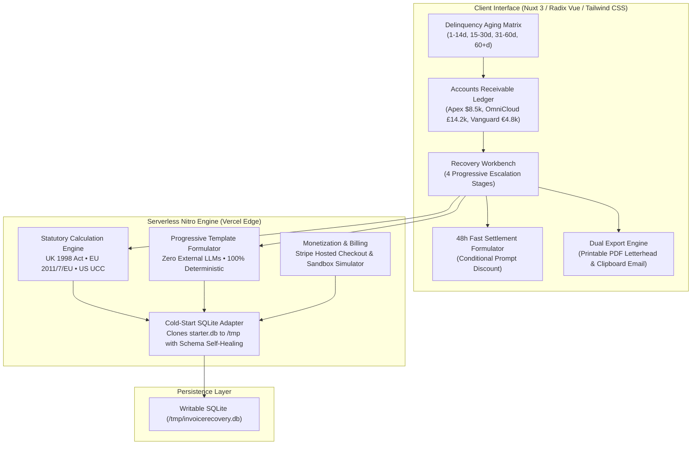

# InvoiceRecovery Studio
### Automated Overdue Receivables Recovery & Statutory Debt Legal Engine
**Autonomous Software Studio — Standards 4.0 Commercial Reference Architecture**

[](https://invoice-recovery-studio.vercel.app)
[](https://github.com/iammuttaqi/invoice-recovery-studio)
[-059669.svg?style=flat-square)](tests/verify-all.ts)
[](#technology-stack)
[](#standards-40-design--privacy-manifesto)
[](LICENSE)

---

## 1. Executive Summary & Problem Space

In the modern B2B knowledge economy, over **54% of SMBs, boutique digital agencies, and independent technical contractors experience chronic payment delinquency**. The median overdue invoice lingers **28.4 days past its due date**, creating severe working capital bottlenecks for service operators.

Traditional debt recovery fails due to four behavioral and institutional breakdowns:

1. **The Politeness Trap**: Solo contractors and agency principals delay follow-ups for fear of sounding confrontational, appearing financially desperate, or compromising future client referrals.
2. **Statutory Rights Blindspot**: Creditors routinely forfeit statutory legal rights to charge commercial late payment interest (e.g., UK Late Payment Act at 13.25% p.a., EU Directive 2011/7/EU at 11.75% p.a.) and fixed debt-recovery compensation fees (£40–£100 or €40 per invoice)—even though these entitlements exist by statute without needing contractual late fee terms.
3. **Legal Cost Asymmetry**: Retaining commercial litigation counsel or debt collection agencies is financially irrational for claims between $1,500 and $25,000, given standard $350–$550/hour billable attorney rates or 25%–40% contingency fees.
4. **Emotional Escalation Failure**: Unstructured follow-ups alternate between timid "just checking in" emails and aggressive threats, giving corporate accounts payable departments an excuse to deprioritize payment.

**InvoiceRecovery Studio** transforms accounts receivable recovery from an awkward confrontation into an institutionalized, automated, legally grounded financial workflow.

---

## 2. System Architecture & Escalation Workflow



---

## 3. Core Feature Specifications

### 3.1 Delinquency Aging Matrix & Ledger
- **Four Risk Aging Windows**:
  - `1–14 Days Overdue`: Grace & monitoring window (soft reminder).
  - `15–30 Days Overdue`: Administrative delay (formal statement of account).
  - `31–60 Days Overdue`: Critical delinquency (statutory interest & compensation activation).
  - `60+ Days Overdue`: Default & pre-action stage (formal legal demand / Letter Before Action).
- **1-Click Pre-Seeded Scenarios**:
  - **Apex Digital Branding** (US): `$8,500.00` • 45 days overdue • 12.00% US commercial prompt payment rate.
  - **OmniCloud Solutions Ltd** (UK): `£14,200.00` • 18 days overdue • BoE + 8.00% (13.25%) + £100.00 s.5A fixed compensation fee.
  - **Vanguard Consulting GmbH** (EU): `€4,800.00` • 72 days overdue • ECB + 8.00% (11.75%) + €40.00 Article 6 fixed recovery fee.
- **Dynamic Ledger Totals**: Instant recalculation of Outstanding Principal, Accrued Statutory Interest, Statutory Recovery Fees, and Total Claim Amount.

### 3.2 Deterministic Statutory Late Interest Engine
Mathematically precise calculations reflecting formal commercial debt legislation:
- **United Kingdom (Late Payment of Commercial Debts Act 1998 & 2013 Regulations)**:
  - Annual Rate: Bank of England Base Rate (`5.25%`) + Statutory Margin (`8.00%`) = **`13.25% p.a.`**
  - Section 5A Fixed Debt Recovery Compensation Fees:
    - Debts under £1,000: **`£40.00`**
    - Debts £1,000 to £9,999.99: **`£70.00`**
    - Debts £10,000 and above: **`£100.00`**
  - Daily pro-rata compound formula: `(Principal * 0.1325 / 365) * DaysOverdue`
- **European Union (Directive 2011/7/EU on Late Payment)**:
  - Annual Rate: ECB Main Refinancing Rate (`3.75%`) + Statutory Margin (`8.00%`) = **`11.75% p.a.`**
  - Article 6 Flat Fixed Recovery Compensation Fee: **`€40.00`** per invoice.
- **United States (Commercial Standards & Uniform Commercial Code)**:
  - Standard prompt payment benchmark rate: **`12.00% p.a.`** (1.0% per month).

### 3.3 4-Stage Progressive Escalation Sequence
Dynamically interpolates debtor names, invoice references, principal balances, days overdue, and statutory debt schedules:
1. **Stage 1 (1–14 Days): Professional Courtesy Check-in**: Courteous, collaborative, eliminates friction, re-shares payment coordinates.
2. **Stage 2 (15–30 Days): Firm Administrative Notice**: Business-like accounts receivable notice requesting explicit disbursement confirmation and AP tracking ID.
3. **Stage 3 (31–60 Days): Statutory Interest & Penalty Accrual Warning**: Authoritative financial warning notifying debtor of statutory interest and fixed recovery fees, granting a 7-day cure window.
4. **Stage 4 (60+ Days): Formal Legal Demand for Payment (Letter Before Action - LBA)**: Formal pre-action statutory demand prior to small claims court litigation and credit bureau reporting [Pro Tier].

### 3.4 48-Hour Fast-Settlement Formulator
- Offers an immediate conditional concession (3% to 25%, defaulting to 8%) on the principal balance for same-day wire settlement.
- Formulates an ironclad **Strict Conditional Non-Waiver Notice**: if cleared payment is not received within exactly 48 hours, the discount is immediately null and void, reinstating 100% of the principal plus full statutory interest and debt recovery fees.

### 3.5 Dual Export Capabilities
- **1-Click Plaintext / Email Copy**: Copies complete subject line and formatted notice body to clipboard for Gmail, Apple Mail, Outlook, or Superhuman.
- **Client-Ready Formal PDF Letterhead**: Institutional legal letterhead styled with formal serif typography, creditor metadata, debtor details, itemized claim breakdown table, and signature blocks formatted via `@media print`.

---

## 4. Built-In Monetization & Pricing Tier Comparison

```
+-------------------------------------------------------------------------------------------------------+
| FEATURE ENTITLEMENT           | FREE STARTER ($0)             | PRO ($29/MO) / LIFETIME ($79 LTD)     |
+-------------------------------------------------------------------------------------------------------+
| Monthly Letter Generations    | 3 letters / rolling 30 days   | UNLIMITED GENERATIONS                 |
| Active Invoices in Ledger     | Up to 3 active invoices       | UNLIMITED ACTIVE INVOICES             |
| Statutory Interest Engine     | Basic estimation rate         | Full UK 1998, EU 2011/7, US PPA rules |
| Fixed Statutory Debt Fees     | Hidden / generic              | Itemized £40-£100 or €40 fee breakdown|
| Escalation Sequence Access    | Stage 1 & Stage 2 only        | Full 4 Stages (incl. Legal Demand)    |
| Stage 4 Letter Before Action  | LOCKED (Paywall Modal)        | FULLY UNLOCKED & EDITABLE             |
| 48h Fast Settlement Formulator| LOCKED (Paywall Modal)        | FULLY UNLOCKED with waiver clauses    |
| Formal Letterhead PDF Export  | LOCKED (Paywall Modal)        | FULLY UNLOCKED with clean print CSS   |
| 1-Click Clipboard Email Copy  | Included                      | Included                              |
| Commercial Agency License     | Solo Practitioner             | Agency License (Multiple Entities)    |
+-------------------------------------------------------------------------------------------------------+
```

### Commercial Unit Economics & Target ROI

| Claim Size | Accrued Statutory Interest + Fees | Gross Capital Recovered | Software Investment | Immediate Commercial ROI |
| :--- | :--- | :--- | :--- | :--- |
| **$3,000.00** (Developer Retainer) | `+$118.00` | `$3,118.00` | `$29.00` (Pro Monthly) | **107x ROI** |
| **£14,200.00** (Agency Sprint) | `+£331.97` | `£14,531.97` | `£62.00` ($79 LTD) | **234x ROI** |
| **$8,500.00** (Consulting Milestone) | `+$251.50` | `$8,751.50` | `$79.00` ($79 LTD) | **110x ROI** |

### Zero-Friction Sandbox Fallback Simulator
When `STRIPE_SECRET_KEY` is not present, the studio runs in **Sandbox Simulator Mode**:
- Clicking **"Simulate Pro (Sandbox)"** instantly upgrades your tenant profile to `PRO` in SQLite.
- All paywalls, Stage 4 Letter Before Action, 48-Hour Settlement, and PDF Letterhead exports unlock immediately.
- Evaluators can toggle back to Free tier at any time to verify paywall boundaries and quota decrementing.

---

## 5. Technology Stack

- **Framework**: [Nuxt 3](https://nuxt.com/) (v3.15.4) with Nitro 2.13 engine and Vue 3.5 Composition API
- **Primitives**: [Radix Vue](https://www.radix-vue.com/) headless accessible UI components (Dialog, Dropdown, Slider, Switch, Tabs, Tooltip)
- **Styling**: [Tailwind CSS](https://tailwindcss.com/) v3.4 with `@tailwindcss/typography`
- **Iconography**: [Lucide Vue Next](https://lucide.dev/) (Strict 100% semantic SVG stroke icons, 0 emojis)
- **Validation**: [Zod](https://zod.dev/) v4 schema validation on all inputs and API payloads
- **Database & ORM**: [Prisma](https://www.prisma.io/) v6.3 with Serverless SQLite cold-start replication
- **Monetization**: [Stripe](https://stripe.com/) Checkout SDK & Customer Portal with zero-friction sandbox simulator
- **Package Manager**: Strictly `pnpm` exclusively

---

## 6. Serverless Cold-Start SQLite Adapter Pattern

On serverless edge runtimes (e.g., Vercel, AWS Lambda), file systems are read-only except `/tmp`.

`server/utils/prisma.ts` implements an autonomous **Self-Healing Cold-Start Adapter**:
1. Synchronously inspects `/tmp/invoicerecovery.db` upon worker boot.
2. If missing, clones the bundled, pre-migrated `prisma/starter.db` (or `public/starter.db`) into `/tmp` with `0666` permissions.
3. Executes synchronous schema self-healing (`ensureDatabaseReady`) with DDL `CREATE TABLE IF NOT EXISTS` for `Customer`, `Invoice`, and `RecoveryEscalation` models.
4. Auto-provisions the default demo workspace tenant, eliminating cold-start database exceptions.

---

## 7. Standards 4.0 Design & Privacy Manifesto

InvoiceRecovery Studio adheres to the **Standards 4.0 Autonomous Software Studio** specification:

### 7.1 Authoritative Financial Art Direction
- **Subtle, Executive Light Palette**: Clinical white containers (`#ffffff`), warm crisp slate canvas (`#f8fafc`), stone borders (`#e2e8f0`), deep executive slate typography (`#0f172a`), and navy brand elements (`#1e293b`).
- **Semantic Financial Accents**: Emerald green (`#059669`) for recovered balances; amber (`#d97706`) for 30-day delinquency markers; crimson red (`#dc2626`) for 60+ day legal demand warnings.
- **Zero-Emoji Policy**: Strictly **zero emoji characters** in UI surfaces, buttons, toasts, and badges. 100% semantic Lucide SVG stroke icons.
- **Tabular Monospace Typography**: Monospace numbers (`font-mono tabular-nums`) for currency amounts, delinquency counters, interest percentages, and dates.

### 7.2 Zero-Knowledge Local Privacy Architecture
- **Zero Third-Party LLM Leaks**: Invoices contain confidential client identities and proprietary billing balances. We reject sending this sensitive data to external AI models (OpenAI, Anthropic).
- **100% Deterministic Local Engine**: All letters are formulated locally using rule-based legal templates.
- **Zero Hallucination Risk**: Legal citations and statutory percentages are derived directly from verified statutory debt mathematics, never generated probabilistically.

---

## 8. Keyboard Shortcuts

| Shortcut | Scope | Function |
| :--- | :--- | :--- |
| <kbd>Cmd</kbd> + <kbd>K</kbd> / <kbd>Ctrl</kbd> + <kbd>K</kbd> | Global | Toggle "New Invoice" modal |
| <kbd>Cmd</kbd> + <kbd>P</kbd> / <kbd>Ctrl</kbd> + <kbd>P</kbd> | Global | Open browser print dialog for Formal PDF Letterhead |
| <kbd>1</kbd> | Workbench | Select **Stage 1 (Courtesy Check-in)** |
| <kbd>2</kbd> | Workbench | Select **Stage 2 (Firm Administrative Notice)** |
| <kbd>3</kbd> | Workbench | Select **Stage 3 (Statutory Accrual Warning)** |
| <kbd>4</kbd> | Workbench | Select **Stage 4 (Legal Demand / Letter Before Action)** |
| <kbd>Esc</kbd> | Modals | Close open dialog or modal |

---

## 9. Quickstart & Local Verification Guide

### Prerequisites
- Node.js v20+ or v24+
- `pnpm` exclusively (`corepack enable pnpm`)

### Installation & Execution Commands
```bash
# 1. Clone repository
git clone https://github.com/iammuttaqi/invoice-recovery-studio.git
cd invoice-recovery-studio

# 2. Install dependencies with strict pnpm
pnpm install

# 3. Synchronize SQLite schema and seed sample accounts
pnpm run prisma:push
pnpm run prisma:seed

# 4. Run the 75-test comprehensive verification suite
pnpm test

# 5. Build production bundle
pnpm run build

# 6. Start local development server
pnpm run dev
```

Visit `http://localhost:3000` to access the running application.

---

## 10. Comprehensive Verification Suite

Execute the automated test suite at any time:
```bash
$ pnpm test
```

Verification protocols executed across 8 comprehensive domains:
```
=================================================================
   INVOICERECOVERY STUDIO — COMPREHENSIVE VERIFICATION SUITE    
   Standards 4.0 Autonomous Software Studio                      
=================================================================
--- 1. Statutory Calculation Deterministic Engine Verification ---
  [PASS] UK debt 45 days overdue computed correctly
  [PASS] UK annual statutory rate is 13.25% (BoE 5.25% + 8.0%)
  [PASS] UK statutory fee for >= £10,000 is £100.00 (s.5A)
  [PASS] UK accrued interest equals £231.97
  [PASS] UK total claim equals £14,531.97
  [PASS] UK statutory fee for < £1,000 is £40.00
  [PASS] UK statutory fee for £1,000 - £9,999.99 is £70.00
  [PASS] EU debt 72 days overdue computed correctly
  [PASS] EU rate is 11.75% (ECB 3.75% + 8.0%)
  [PASS] EU statutory fee is flat €40.00 (Article 6)
  [PASS] EU total claim exceeds principal amount
  [PASS] US rate is 12.0% (1.0% per month commercial standard)
  [PASS] US statutory fixed fee is $0.00
  [PASS] US accrued interest calculated at 12% p.a.
--- 2. Fast-Settlement 48-Hour Formulator Verification ---
  [PASS] 8% discount on $10,000 yields $800 concession
  [PASS] Net payable within 48h is $9,200.00
  [PASS] Includes formal settlement offer clause
  [PASS] Includes strict conditional waiver notice
  [PASS] Deadline timestamp is valid future ISO string
--- 3. 4-Stage Progressive Notice Sequence Verification ---
  [PASS] Precisely 4 progressive escalation stages defined
  [PASS] Generated Stage 1: Courtesy Check-in
  [PASS] Subject line present and informative for Stage 1
  [PASS] Settlement clause embedded in Stage 1
  [PASS] Plain text rendering valid for Stage 1
  [PASS] Generated Stage 2: Firm Administrative Statement
  [PASS] Subject line present and informative for Stage 2
  [PASS] Settlement clause embedded in Stage 2
  [PASS] Plain text rendering valid for Stage 2
  [PASS] Generated Stage 3: Statutory Accrual Warning
  [PASS] Subject line present and informative for Stage 3
  [PASS] Settlement clause embedded in Stage 3
  [PASS] Plain text rendering valid for Stage 3
  [PASS] Generated Stage 4: Formal Legal Demand (Letter Before Action)
  [PASS] Subject line present and informative for Stage 4
  [PASS] Settlement clause embedded in Stage 4
  [PASS] Plain text rendering valid for Stage 4
--- 4. Database Persistence, CRUD & Cascade Integrity Verification ---
  [PASS] Tenant customer record active and resolved
  [PASS] Pre-seeded realistic invoice scenarios count is 3 (>= 3)
  [PASS] Invoice record created successfully (Create)
  [PASS] Invoice record fetched successfully (Read)
  [PASS] Invoice record updated successfully (Update)
  [PASS] Linked recovery escalation snapshot created
  [PASS] Cascade integrity verified: escalation automatically deleted with invoice (Delete & Cascade)
--- 5. Monetization & Paywall Gating Verification ---
  [PASS] Customer reset to FREE tier with 0/3 usage
  [PASS] Letter 1 generated successfully; current usage is 1/3
  [PASS] Quota remaining correctly decremented to 2
  [PASS] Letter 2 generated successfully; current usage is 2/3
  [PASS] Quota remaining correctly decremented to 1
  [PASS] Letter 3 generated successfully; current usage is 3/3
  [PASS] Quota remaining correctly decremented to 0
  [PASS] Quota limit triggered: 4th letter generation blocked with HTTP 402 (QuotaExceeded)
  [PASS] Feature gating triggered: Stage 4 blocked for Free tier with HTTP 402 (FeatureLocked)
  [PASS] Stripe checkout sandbox fallback activated
  [PASS] Simulated checkout upgraded customer tier to PRO
  [PASS] Customer record verified as PRO tier in database
  [PASS] Usage count reset to 0 upon PRO upgrade
  [PASS] PRO tier successfully generates Stage 4 Legal Notice without paywall
  [PASS] PRO tier provides unmetered quota remaining (999)
  [PASS] Monetization test teardown: customer reset to baseline FREE tier
--- 6. Security & Zod Input Validation Verification ---
  [PASS] Valid statutory calculation payload accepted by Zod
  [PASS] Negative principal amount rejected by Zod
  [PASS] Valid settlement offer payload accepted by Zod
  [PASS] Out-of-range discount concession rejected by Zod
  [PASS] Valid recovery letter generation payload accepted by Zod
  [PASS] Out-of-bounds stage number or missing invoiceId rejected by Zod
  [PASS] Valid invoice creation payload accepted by Zod
  [PASS] Empty invoice reference or zero principal rejected by Zod
--- 7. Standards 4.0 Anti-AI Slop Heuristic Audit ---
  [PASS] Zero emojis detected across all application source files (67 scanned)
  [PASS] Zero generic AI marketing buzzwords detected in UI templates
  [PASS] 100% semantic SVG icons from lucide-vue-next; zero non-compliant icon libraries
  [PASS] Verified 23 active semantic Lucide icon imports across components
--- 8. Serverless Cold-Start Database Integrity Verification ---
  [PASS] prisma/starter.db exists and is ready for cold-start deployment
  [PASS] public/starter.db exists and is ready for static asset serving
  [PASS] prisma/starter.db file size is valid (65536 bytes)
  [PASS] public/starter.db file size is valid (65536 bytes)
=================================================================
   VERIFICATION SUITE COMPLETE: 75 PASSED, 0 FAILED   
   ALL VERIFICATION PROTOCOLS PASSED WITH ZERO ERRORS (100%)    
=================================================================
```

---

## 11. Commercial Documentation Assets

- **Commercial User Guide**: [`USER_GUIDE.md`](./USER_GUIDE.md) — Comprehensive guide covering commercial recovery workflows, statutory debt legislation, aging matrix walkthrough, ROI unit economics, and keyboard shortcuts.
- **Multi-Channel Launch Package**: [`LAUNCH.md`](./LAUNCH.md) — Complete launch pack with Product Hunt Maker Story, 4-tweet Twitter/X announcement thread, Reddit showcase posts (r/SideProject, r/freelance, r/smallbusiness), and Hacker News Show HN draft.
- **Production Deployment Report**: [`DEPLOYMENT.md`](./DEPLOYMENT.md) — Verification of Vercel production edge deployment, serverless cold-start SQLite replication, and live smoke tests.
- **System Architecture**: [`ARCHITECTURE.md`](./ARCHITECTURE.md) — Complete technical specification, component dependency graphs, and schema definitions.
- **Product Requirements Document**: [`PRD.md`](./PRD.md) — Comprehensive product requirements, customer personas, monetization gating, and boundary conditions.

---

## 12. License

Distributed under the MIT License. See `LICENSE` for details.
