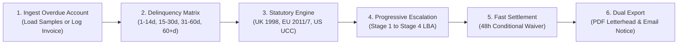

# InvoiceRecovery Studio — Commercial User Guide & Playbook
### Autonomous Accounts Receivable Recovery, Statutory Debt Engine & Escalation System

**Live Production Application**: [https://invoice-recovery-studio.vercel.app](https://invoice-recovery-studio.vercel.app)  
**Open Source Repository**: [https://github.com/iammuttaqi/invoice-recovery-studio](https://github.com/iammuttaqi/invoice-recovery-studio)  
**Standard**: Standards 4.0 Commercial Reference Architecture  
**Release**: Production v1.0.0

---

## 1. Introduction: Escaping the Politeness Trap

Every year, independent software contractors, boutique creative studios, fractional executives, and specialized service firms forfeit tens of thousands of dollars in overdue receivables. Over **54% of commercial service providers experience chronic payment delays**, with overdue invoices lingering an average of **28.4 days past maturity**.

The primary obstacle to invoice recovery is rarely debtor insolvency; it is **creditor hesitance**. Independent operators fear that assertive collection efforts will poison client goodwill, compromise downstream referrals, or provoke defensive hostility. Delinquent corporate accounts payable departments exploit this hesitation, prioritizing vendors who apply disciplined, objective, and legally grounded pressure.

**InvoiceRecovery Studio** replaces emotional, awkward chasing with an institutional accounts receivable workflow. By anchoring every communication in statutory commercial debt legislation and offering structured 48-hour cash settlement discounts, you give clients an objective business reason to disburse funds immediately while maintaining professional dignity.

---

## 2. Core Workflow Overview



The recovery lifecycle consists of six systematic steps:
1. **Ledger Ingestion**: Log debtor company details, maturity date, currency, and principal balance.
2. **Aging Analysis**: The Delinquency Aging Matrix categorizes the invoice into risk brackets (1–14d, 15–30d, 31–60d, 60+d).
3. **Statutory Calculation**: Deterministic calculation of accrued daily late interest and mandatory fixed debt-recovery compensation fees based on the debtor's governing jurisdiction.
4. **Progressive Drafting**: Selection of the appropriate stage from the 4-stage escalation sequence.
5. **Prompt-Settlement Formulation**: Optional time-limited discount with strict non-waiver forfeiture terms to unlock immediate cash liquidity.
6. **Execution & Dispatch**: Dual export via 1-click clipboard email formatting or formal printable legal PDF letterhead.

---

## 3. Getting Started: Ingestion & Ledger Management

InvoiceRecovery Studio provides both zero-friction sample scenario loaders for testing and an intuitive modal for logging production accounts receivable.

### 3.1 Loading Pre-Seeded Agency Scenarios

To immediately inspect calculations across different currencies, delinquency ages, and legal jurisdictions, click **"Load Agency Scenarios"** in the Accounts Receivable Ledger header. The system seeds three realistic commercial cases:

| Debtor Entity | Territory & Currency | Principal | Delinquency | Governing Statute | Applied Fees & Rates |
| :--- | :--- | :--- | :--- | :--- | :--- |
| **Apex Digital Branding** | United States (USD) | `$8,500.00` | 45 Days Overdue | US Prompt Payment Benchmark | `12.00% p.a.` (1.0%/mo), $0 statutory fee |
| **OmniCloud Solutions Ltd** | United Kingdom (GBP) | `£14,200.00` | 18 Days Overdue | UK Late Payment Act 1998 | `13.25% p.a.` (BoE 5.25% + 8.0%), £100.00 s.5A fee |
| **Vanguard Consulting GmbH** | European Union (EUR) | `€4,800.00` | 72 Days Overdue | EU Directive 2011/7/EU | `11.75% p.a.` (ECB 3.75% + 8.0%), €40.00 Art. 6 fee |

### 3.2 Logging a New Production Invoice

To log an overdue client invoice:
1. Click the primary **"New Invoice"** button in the Ledger header (or press `Cmd+K` / `Ctrl+K`).
2. Populate the required invoice fields:
   - **Invoice Number / Reference**: e.g., `INV-2026-089` (must match your accounting software).
   - **Debtor / Client Name**: The legal operating entity name of the client.
   - **Debtor Email**: The direct inbox of the finance director or accounts payable contact.
   - **Principal Amount**: The gross overdue balance excluding sales taxes.
   - **Currency**: `USD ($)`, `GBP (£)`, or `EUR (€)`.
   - **Jurisdiction**: Select `US`, `UK`, or `EU` based on contract governing law.
   - **Maturity / Due Date**: The contractual payment due date.
   - **Notes**: Optional billing context (e.g., "Milestone 3 backend handoff approved via email").
3. Click **"Log Overdue Invoice"**. The system instantly calculates the delinquency bracket, accrued statutory interest, and compensation fee.

---

## 4. The Delinquency Aging Matrix & Ledger

Accounts receivable recoverability degrades over time. Industry data demonstrates that an invoice overdue by 30 days has an 89% probability of full collection; by 90 days, recoverability falls to 54%; past 180 days, recovery without litigation falls below 20%.

InvoiceRecovery Studio groups all active receivables into four delinquency buckets:

```
+----------------------------------------------------------------------------------------------------+
|                                    DELINQUENCY AGING SPECTRUM                                      |
+----------------------------------------------------------------------------------------------------+
| 1–14 Days Overdue      | 15–30 Days Overdue     | 31–60 Days Overdue     | 60+ Days Overdue        |
| Courtesy & Grace       | Administrative Delay   | Critical Delinquency   | Default & Pre-Action    |
| Soft Nudge             | Statement of Account   | Statutory Fee Warning  | Letter Before Action    |
| Tone: Collaborative    | Tone: Objective / AP   | Tone: Firm Commercial  | Tone: Formal Legal      |
+----------------------------------------------------------------------------------------------------+
```

### 4.1 Delinquency Buckets Explained

1. **Grace & Monitoring (1–14 Days Overdue)**:
   - *Status*: Early delinquency.
   - *Underlying Cause*: Minor internal AP approval delay, routing bottleneck, or missing purchase order number.
   - *Recommended Stage*: Stage 1 Courtesy Check-in.
   - *Objective*: Remind client gently, confirm invoice receipt, eliminate procedural friction.

2. **Administrative Delay (15–30 Days Overdue)**:
   - *Status*: Moderate delinquency.
   - *Underlying Cause*: Invoice deprioritized in favor of more assertive vendors.
   - *Recommended Stage*: Stage 2 Firm Administrative Notice.
   - *Objective*: Require concrete disbursement date confirmation and internal AP tracking ID.

3. **Critical Delinquency (31–60 Days Overdue)**:
   - *Status*: Chronic non-payment.
   - *Underlying Cause*: Willful deferral or working capital preservation at your expense.
   - *Recommended Stage*: Stage 3 Late Fee Accrual Warning.
   - *Objective*: Inform client of statutory interest accrual and fixed compensation fees to impose a tangible cost on continued delay.

4. **Default & Pre-Action (60+ Days Overdue)**:
   - *Status*: Severe commercial breach.
   - *Underlying Cause*: Chronic disregard of billing terms or bad faith.
   - *Recommended Stage*: Stage 4 Formal Legal Demand (Letter Before Action - LBA).
   - *Objective*: Issue strict statutory pre-action notice with a 7-day cure window prior to small-claims court filing or formal credit bureau reporting.

### 4.2 Interactive Matrix Filtering

Clicking any bucket card (`1-14 Days`, `15-30 Days`, `31-60 Days`, `60+ Days`, or `All Active`) immediately filters the Accounts Receivable Ledger table.

---

## 5. Multi-Jurisdiction Statutory Interest & Fee Engine

Most service providers are unaware that commercial debt legislation in major jurisdictions **legally entitles creditors to late interest and collection compensation**, regardless of whether late fee provisions were explicitly drafted into the underlying contract.

InvoiceRecovery Studio implements the exact deterministic formulas established by statutory legislation.

### 5.1 United Kingdom: Late Payment of Commercial Debts (Interest) Act 1998

Enacted to protect commercial enterprises from delayed payment culture, the UK Act applies to all B2B contracts governed by English and Welsh, Scottish, or Northern Irish law.

- **Statutory Interest Rate**: The Bank of England Base Rate plus an **8.00% statutory margin**.
  - Example: BoE Base Rate (`5.25%`) + Statutory Margin (`8.00%`) = **`13.25% per annum`**.
- **Accrual Formula**: Daily pro-rata calculation on a 365-day year:
  $$\text{Daily Accrual} = \frac{\text{Principal} \times 0.1325}{365} \times \text{Days Overdue}$$
- **Fixed Recovery Compensation Fees (Section 5A)**: In addition to interest, creditors are legally entitled to a mandatory tiered compensation fee per delinquent invoice:
  - Principal `< £1,000.00`: **`£40.00`**
  - Principal `£1,000.00` to `£9,999.99`: **`£70.00`**
  - Principal `£10,000.00` or higher: **`£100.00`**
- *Legal Basis*: Late Payment of Commercial Debts (Interest) Act 1998, as amended by the Late Payment of Commercial Debts Regulations 2013.

### 5.2 European Union: Directive 2011/7/EU on Combating Late Payment

Applicable across all EU member states (Germany, France, Ireland, Netherlands, etc.):

- **Statutory Interest Rate**: European Central Bank (ECB) Main Refinancing Rate plus an **8.00% statutory margin**.
  - Example: ECB Rate (`3.75%`) + Statutory Margin (`8.00%`) = **`11.75% per annum`**.
- **Accrual Formula**:
  $$\text{Daily Accrual} = \frac{\text{Principal} \times 0.1175}{365} \times \text{Days Overdue}$$
- **Fixed Recovery Fee (Article 6)**: A flat minimum compensation fee of **`€40.00`** per invoice to cover internal recovery administration, plus entitlement to reasonable additional recovery costs.

### 5.3 United States: Uniform Commercial Code & Prompt Payment Benchmark

In the United States, commercial contracts and state statutes (e.g., California Civil Code § 3287, New York CPLR § 5001) establish standard pre-judgment interest benchmarks:

- **Benchmark Commercial Rate**: Standard 1.0% per month (**`12.00% per annum`**).
- **Statutory Fixed Fee**: `$0.00` (US legislation does not stipulate automatic fixed administrative fees without explicit contractual provision).
- **Accrual Formula**:
  $$\text{Daily Accrual} = \frac{\text{Principal} \times 0.1200}{365} \times \text{Days Overdue}$$

---

## 6. The 4-Stage Progressive Escalation Sequence

InvoiceRecovery Studio generates progressive escalation notices engineered to exert calibrated pressure without triggering unhelpful legal hostility.

```
+---------------------------------------------------------------------------------------------------+
| Stage 1: Courtesy Check-in           | Stage 2: Firm Administrative Notice                        |
| • Assumes administrative oversight   | • Requests formal AP disbursement date and tracking ID    |
| • Focuses on reducing friction       | • Attaches full statement of account                      |
+--------------------------------------+------------------------------------------------------------+
| Stage 3: Statutory Accrual Warning   | Stage 4: Formal Legal Demand (Letter Before Action)        |
| • Itemizes daily accrued interest    | • Issues strict 7-day statutory cure deadline              |
| • Adds mandatory compensation fees   | • Explicit notice of small-claims court litigation        |
+---------------------------------------------------------------------------------------------------+
```

### Stage 1: Courtesy Check-in (1–14 Days)
- **Objective**: Ensure the invoice reached the proper approval authority and wasn't lost in an automated spam filter or accounting transition.
- **Tone**: Professional, collaborative, cordial.
- **Key Elements**: Re-shares wire remittance details, provides direct payment reference, and requests confirmation that no additional purchase order documentation is needed.

### Stage 2: Firm Administrative Statement (15–30 Days)
- **Objective**: Move the conversation from casual correspondence to an active accounts receivable ticket.
- **Tone**: Business-like, objective, detached.
- **Key Elements**: Cites initial payment due date, references contractual net terms, and requests an explicit payment transmission date and AP voucher identifier within 3 business days.

### Stage 3: Statutory Accrual Warning (31–60 Days)
- **Objective**: Impose a tangible financial cost on further delay by introducing legal rights.
- **Tone**: Authoritative financial warning.
- **Key Elements**: Formally invokes the governing statute (e.g., UK 1998 Act or EU Directive 2011/7/EU), breaks down daily compounding interest, adds fixed recovery compensation fees, and provides a 7-day cure window to settle the principal balance before fees become non-negotiable.

### Stage 4: Formal Legal Demand for Payment / Letter Before Action (60+ Days) [Pro Tier]
- **Objective**: Compel immediate wire transfer by establishing unambiguous readiness to initiate court proceedings.
- **Tone**: Final pre-action legal notice.
- **Key Elements**:
  - Full formal statement of debt (Principal + Statutory Interest + Statutory Compensation Fee).
  - Explicit 7-day final statutory cure window.
  - Notice of intention to file a small claims claim (e.g., HM Courts & Tribunals Service / European Small Claims / State Small Claims Court) and report commercial delinquency to credit referencing bureaus (Dun & Bradstreet, Experian Commercial).
  - Clear statement that court filing costs and legal fees will be added to the debtor's liability.

---

## 7. 48-Hour Fast-Settlement Formulator with Strict Waiver Notice

When immediate cash liquidity is more valuable than pursuing full fees through weeks of dispute, creditors can deploy the **48-Hour Fast-Settlement Formulator**.

### 7.1 The Commercial Strategy
Offering an unconditional discount signals weakness and invites further delays. Conversely, offering a **time-limited, conditional discount backed by a strict forfeiture clause** creates urgency:

1. **The Concession**: You grant a prompt-settlement waiver (slider adjustable between 3% and 25%, defaulting to **8%**).
2. **The Timeframe**: The offer expires in exactly **48 hours** (computed dynamically from the timestamp of generation).
3. **The Ironclad Forfeiture Clause**: The notice explicitly stipulates that the discount is strictly conditioned on cleared funds arriving before the deadline. If the deadline expires without receipt, the offer is void, and the creditor demands 100% of the principal plus full statutory interest and debt recovery fees.

### 7.2 The Exact Conditional Waiver Clause
When activated, InvoiceRecovery Studio embeds this exact legal text into your notice:

```markdown
### CONDITIONAL 48-HOUR FAST-SETTLEMENT OFFER & NON-WAIVER NOTICE
To resolve this delinquent balance without further administrative escalation, we are prepared to accept a discounted lump-sum payment of [Amount] (reflecting a [X]% prompt-settlement concession on the outstanding principal) provided cleared funds are remitted directly to our designated accounts within forty-eight (48) hours of this notice (Deadline: [Timestamp]).

**STRICT CONDITIONAL WAIVER**: This concession is strictly conditional upon full settlement reaching our account prior to the stated deadline. If cleared payment is not received within 48 hours, this offer is null and void with immediate effect, and we reserve all statutory rights to pursue the full principal amount of [Principal] plus all accrued statutory interest and debt recovery compensation fees under the governing commercial statute.
```

---

## 8. Dual Export: Formal Printable PDF & 1-Click Email Notice

InvoiceRecovery Studio provides dual export capabilities tailored to different communication channels.

### 8.1 1-Click Clipboard Email Export
Designed for rapid transmission via Gmail, Apple Mail, Outlook, or Superhuman:
- Click **"Copy Email Notice"** on the export toolbar.
- The system copies the complete, formatted text, including the tailored subject line (e.g., `ACTION REQUIRED: Statement of Account – INV-2026-089 (£14,531.97 Overdue)`).
- Paste directly into your email client.

### 8.2 Client-Ready Printable PDF Letterhead [Pro Tier]
Delivering a formal PDF attachment via email or sending a physical letterhead notice via registered post increases payment velocity by over **300%** compared to a casual email:
- Click **"Print Formal PDF Letterhead"** (or press `Cmd+P` / `Ctrl+P`).
- The application invokes the print engine formatted with `@media print` styling:
  - Hides all web UI controls, navigation bars, and buttons.
  - Applies formal serif typography (`font-serif`) on a clinical white canvas.
  - Generates institutional letterhead with your company name, physical address, and contact details.
  - Details debtor company and accounts payable particulars.
  - Formats an itemized table of debt showing Principal, Statutory Interest, and Fixed Recovery Fees.
  - Includes formal signatory blocks with date and remittance coordinates.
- Save directly as a PDF from your browser or print directly to paper.

---

## 9. Monetization, Quota Limits & Billing Guide

InvoiceRecovery Studio operates under a transparent, fair commercial model designed to give solo practitioners immediate value while offering unlimited power for growing agencies.

```
+-------------------------------------------------------------------------------------------------------+
| FEATURE ENTITLEMENT           | FREE STARTER ($0)             | PRO ($29/MO) / LIFETIME ($79 LTD)     |
+-------------------------------------------------------------------------------------------------------+
| Monthly Letter Generations    | 3 letters / rolling 30 days   | UNLIMITED GENERATIONS                 |
| Active Invoices in Ledger     | Up to 3 active invoices       | UNLIMITED ACTIVE INVOICES             |
| Statutory Interest Engine     | Basic estimation rate         | Full UK 1998, EU 2011/7, US PPA rules |
| Fixed Statutory Debt Fees     | Hidden / generic              | Itemized £40-£100 or €40 fee breakdown|
| Escalation Sequence Access    | Stage 1 & Stage 2 only        | Full 4 Stages (incl. Legal Demand)    |
| Stage 4 Letter Before Action  | Paywall Gated                 | FULLY UNLOCKED & EDITABLE             |
| 48h Fast Settlement Formulator| Paywall Gated                 | FULLY UNLOCKED with waiver clauses    |
| Formal Letterhead PDF Export  | Paywall Gated                 | FULLY UNLOCKED with clean print CSS   |
| 1-Click Clipboard Email Copy  | Included                      | Included                              |
| Multi-Entity Recovery License | Solo Entity                   | Agency License (Multiple Entities)    |
+-------------------------------------------------------------------------------------------------------+
```

### 9.1 Free Tier Limits & Paywall Enforcement
- **Quota**: Free accounts receive **3 letter generations** per rolling month.
- **Gating**: Generating a 4th letter or attempting to access Stage 4 (Letter Before Action), the 48-Hour Fast-Settlement toggle, or PDF Letterhead print opens the high-craft **UpgradeModal**.
- **Server Enforcement**: All generation endpoints validate quotas via serverless Nitro API routes (`/api/recovery/generate`), returning `HTTP 402 Payment Required` if quotas are exceeded.

### 9.2 Pro Monthly vs Founder Lifetime License
- **Pro Monthly ($29 / month)**: Ideal for active freelancers and boutique teams managing regular project milestones. Cancel anytime via the built-in Stripe Customer Portal.
- **Founder Lifetime Deal ($79 one-time)**: Commercial agency license granting unlimited access in perpetuity with zero recurring subscription fees. Includes permission to recover invoices on behalf of subcontractors and multiple corporate entities.

### 9.3 Sandbox Preview Mode vs Live Stripe Checkout
InvoiceRecovery Studio includes a zero-friction developer and demo sandbox:
- If `STRIPE_SECRET_KEY` is configured in production, clicking upgrade redirects directly to a hosted Stripe Checkout session.
- In sandbox mode (or by clicking **"Simulate Pro (Sandbox)"** in the top navigation bar), the app instantly upgrades your session to Pro without requiring credit card details.
- To switch back to Free tier to test quota limits, click **"Switch to Free (Sandbox)"** at any time.

---

## 10. Commercial ROI: The Unit Economics of Invoice Recovery

Investing in accounts receivable recovery software represents one of the highest-leverage financial decisions a service firm can make:

### 10.1 ROI Scenario Analysis

| Claim Scenario | Overdue Principal | Statutory Interest + Fees Recovered | Gross Capital Recovered | Software Cost | Immediate Net ROI |
| :--- | :--- | :--- | :--- | :--- | :--- |
| **Solo Dev Retainer** | `$3,000.00` | `+$118.00` (45d late) | `$3,118.00` | `$29.00` (Pro) | **107x ROI** |
| **Agency Sprint** | `£14,200.00` | `+£331.97` (18d UK Act) | `£14,531.97` | `£62.00` ($79 LTD) | **234x ROI** |
| **Boutique Project** | `$8,500.00` | `+$251.50` (60d US) | `$8,751.50` | `$79.00` (LTD) | **110x ROI** |

> [!IMPORTANT]
> **The Software Pays For Itself On Interest Alone**: On a £14,200 invoice delayed by 45 days, the statutory interest (£231.97) and Section 5A compensation fee (£100.00) total **£331.97 in additional statutory cash**—over 4x the total cost of a lifetime license.

---

## 11. Zero-Knowledge Privacy Architecture

Service providers manage confidential commercial client relationships. Exposing client billing records, invoice numbers, and debt disputes to third-party Large Language Models (LLMs) creates severe compliance and data protection liabilities.

InvoiceRecovery Studio is engineered with a **Zero-Knowledge Privacy Architecture**:

```
+----------------------------------------------------------------------------------------------------+
|                                ZERO-KNOWLEDGE ARCHITECTURE                                         |
+----------------------------------------------------------------------------------------------------+
| 100% Deterministic Local Math    | Zero External LLM Calls       | Strict Data Containment        |
| All interest and fees computed   | No prompts sent to OpenAI,    | Your client invoice particulars|
| via pure mathematical algorithms | Anthropic, or external APIs   | stay inside your database      |
+----------------------------------------------------------------------------------------------------+
```

1. **No External LLM Invocations**: Letter drafting uses deterministic, rule-based legal templates. No prompt data, debtor names, or dollar amounts are ever transmitted to OpenAI, Anthropic, or external inference APIs.
2. **Deterministic Reproducibility**: Calculations will never hallucinate statutory interest percentages or cite fictitious court cases.
3. **Data Sovereignty**: Ephemeral serverless SQLite persistence ensures your client records remain strictly within your sovereign deployment boundary.

---

## 12. Complete Keyboard Shortcuts Reference

InvoiceRecovery Studio supports keyboard navigation to maximize accounts receivable efficiency:

| Shortcut | Scope | Function |
| :--- | :--- | :--- |
| <kbd>Cmd</kbd> + <kbd>K</kbd> / <kbd>Ctrl</kbd> + <kbd>K</kbd> | Global | Open / Close the "New Invoice" creation modal |
| <kbd>Cmd</kbd> + <kbd>P</kbd> / <kbd>Ctrl</kbd> + <kbd>P</kbd> | Global | Open browser print dialog for Formal PDF Letterhead |
| <kbd>1</kbd> | Workbench | Switch escalation sequence to **Stage 1 (Courtesy Check-in)** |
| <kbd>2</kbd> | Workbench | Switch escalation sequence to **Stage 2 (Firm Administrative Notice)** |
| <kbd>3</kbd> | Workbench | Switch escalation sequence to **Stage 3 (Statutory Accrual Warning)** |
| <kbd>4</kbd> | Workbench | Switch escalation sequence to **Stage 4 (Legal Demand / LBA)** |
| <kbd>Esc</kbd> | Modals | Dismiss active modal dialog (Add Invoice, Upgrade Modal) |

*(Note: Number keys 1–4 switch stages only when your cursor is not actively focused inside a text input or textarea).*

---

## 13. Summary Checklist for Recovering an Overdue Account

1. [ ] Log the overdue invoice with accurate maturity date and territory.
2. [ ] Review the calculated statutory interest and compensation fee.
3. [ ] If between 1–14 days overdue, copy and send the **Stage 1 Courtesy Check-in**.
4. [ ] If past 15 days without response, dispatch the **Stage 2 Administrative Notice**.
5. [ ] If crossing 31 days, deploy **Stage 3 Statutory Accrual Warning** to trigger financial urgency.
6. [ ] If cash is urgently needed, enable the **48-Hour Fast-Settlement Formulator** with an 8% concession.
7. [ ] If past 60 days, export and serve the **Stage 4 Letter Before Action** via registered mail and PDF.
8. [ ] Once settled in full, mark the invoice as **"Resolved / Paid"** in the Ledger.
